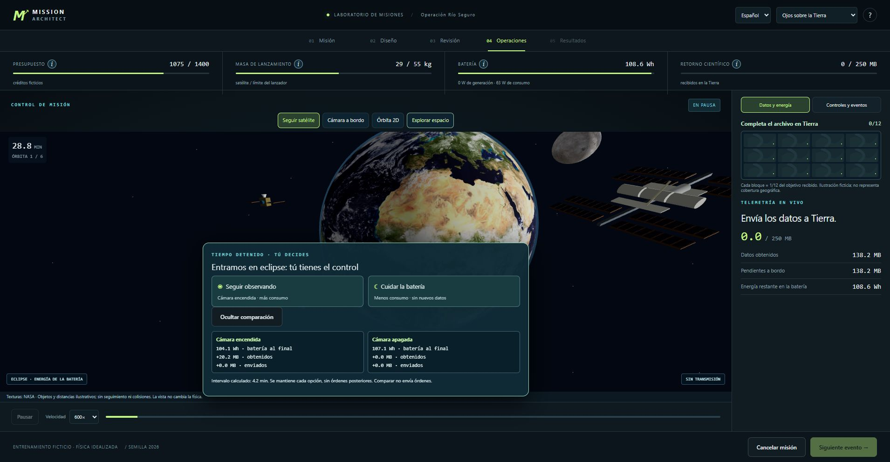

# Mission Architect

Juego educativo de estrategia e ingeniería para **NASA Space Apps Challenge 2026, reto 13: Space Mission Design Game**. Diseña un satélite de observación terrestre, revisa sus recursos, opera una misión reproducible y aprende por qué funcionó o falló.

## Descargar y jugar en Windows

**[Descargar Mission Architect v0.2.0-rc.1 · Windows x64 portable](https://github.com/ShelB123/mission-architect-spaceapps-2026/releases/download/v0.2.0-rc.1/Mission-Architect-0.2.0-rc.1-Windows-x64.zip)** · [Notas y archivos de la candidata](https://github.com/ShelB123/mission-architect-spaceapps-2026/releases/tag/v0.2.0-rc.1)

1. Descarga el ZIP desde Releases.
2. Clic derecho → **Extraer todo** a una carpeta donde puedas escribir.
3. Entra en la carpeta extraída y abre **Mission Architect.exe**. Conserva junto al ejecutable las carpetas y DLL incluidas. No lo ejecutes directamente dentro del ZIP.
4. Elige idioma y misión; pulsa **Diseñar satélite**, cambia componentes, revisa y lanza. En operaciones puedes alternar **Seguir satélite**, **Cámara a bordo**, **Órbita 2D** y **Explorar espacio**.
5. Prueba apagar la cámara durante el eclipse y compara los resultados usando la misma semilla. F11 cambia a pantalla completa; Alt muestra el menú.

Incluye Chromium/Electron y todos los recursos del juego: **no necesitas Node.js, npm, Brave ni un servidor para jugar**. Las referencias NASA son enlaces opcionales y requieren Internet. Es una candidata sin firma digital; verifica origen y SHA256. No requiere permisos de administrador. El idioma se guarda en el perfil local; las partidas no tienen guardado persistente.

## Qué incluye

- Flujo misión → diseño → revisión → operaciones → resultados; cuatro escenarios con presupuestos, objetivos y plazos distintos.
- Satélite procedural 3D, inspección y vista esquemática, cámara de seguimiento y cámara a bordo. Tierra Blue Marble, Luna LROC y explorador de ISS y otros objetos.
- Energía, masa, presupuesto y datos; eventos de entrenamiento con semilla y órdenes reales de encendido/apagado de cámara.
- Modo comandante con pausas para decidir, comparación calculada de alternativas y diagnóstico al terminar. Riverwatch propone una solicitud ficticia de observación de inundaciones.
- Español/inglés, ayuda opcional y alternativa 2D si WebGL 2 falla, con reintento gráfico.

Las especificaciones de hardware, créditos, contactos y eventos son **parámetros sintéticos**. Las imágenes NASA tienen sus créditos; el juego no calcula posiciones reales de ISS/basura, colisiones, inundaciones, calidad científica ni vidas salvadas. La escena 3D representa la configuración y estados del motor; no determina resultados físicos.

Captura real de la interfaz web en Brave antes del empaquetado; no se presenta como evidencia de la prueba nativa de Windows.

## Requisitos conocidos

Windows de 64 bits; entorno de ejecución disponible: Windows 10 x64, build 19045, Core i7-6500U y 8 GiB de RAM. El inicio nativo fue observado; la prueba visual completa del ejecutable requiere autorización del control del PC (ver QA). Esto describe el equipo de prueba, **no un mínimo medido**. WebGL 2 y un controlador gráfico compatible para 3D; 2D permite completar la misión cuando falla el renderizado. Reserva aproximadamente 1 GB para descargar y extraer con holgura. No se han medido FPS, consumo máximo de RAM ni compatibilidad en todas las GPU; Windows 11 y otras configuraciones requieren pruebas del equipo. No hay compilaciones ARM64/macOS/Linux en esta entrega.

## Desarrollo y compilación

React 19 + TypeScript + Vite; Three.js y React Three Fiber; Electron añade una ventana nativa con los mismos archivos web. Usa Git, Node.js 22.23.4 (archivo .nvmrc) y npm 12.2.2. Visual Studio Code es opcional; no necesitas Unity, C++, Python ni Visual Studio para compilar este proyecto. La instalación inicial requiere Internet para dependencias y el runtime Electron.

~~~bash
git clone https://github.com/ShelB123/mission-architect-spaceapps-2026.git
cd mission-architect-spaceapps-2026
git switch integration/windows-rc-20261115
npm install --global npm@12.2.2
npm ci
npm run dev
~~~

Abre la URL de Vite en **Brave** para probar la versión web. Para la versión de escritorio de desarrollo:

~~~bash
npm run build
npm run desktop:dev
~~~

Para reproducir el ZIP de Windows desde la candidata:

~~~bash
git switch --detach v0.2.0-rc.1
npm ci
npm test -- --maxWorkers=2
npm audit
npm run package:win
npm run verify:package -- release/Mission-Architect-0.2.0-rc.1-Windows-x64.zip
~~~

El último comando valida checksum, arquitectura PE x64, entrada Electron e integridad de todos los recursos web en app.asar. Los ZIP se escriben en release/ (ignorado por Git); el directorio portable queda bajo release/COMMIT/. BUILD-INFO.json incluye versión, commit, estado limpio/sucio e inventario SHA256. Las fechas y metadatos de ZIP pueden cambiar entre compilaciones: se reproducen los recursos, no se promete identidad binaria bit a bit. Windows CI ejecuta los mismos comandos y adjunta artefactos.

## Código y ramas

| Ubicación | Responsabilidad |
|---|---|
| src/engine | Órbita, recursos, simulación y puntuación puras |
| src/types/contracts.ts | Contratos compartidos; coordinar cambios con integración |
| src/data/catalog.ts | Hardware y lanzadores sintéticos |
| src/ui y src/App.tsx | Flujo del juego, decisiones, telemetría e interfaz |
| src/visualization | Modelos procedurales, cámaras y escenas 3D |
| src/i18n | Traducción español/inglés |
| public/textures | Imágenes locales NASA y créditos |
| desktop | Ventana Electron y protocolo restringido de recursos locales |
| scripts | Empaquetado y verificación del ZIP |
| tests | Motores, aceptación, interfaz y límite de recursos del escritorio |
| docs | Física, fuentes, comparación de ramas y evidencia de QA |

**Candidata de entrega:** integration/windows-rc-20261115 / etiqueta v0.2.0-rc.1. Base main 9232027 (mismo árbol que nuestra rama 627e4ca); integra también la ampliación orbital 1dde820. Las ramas originales siguen conservadas. main solo se actualiza mediante revisión del PR de integración. Consulta [comparación completa](docs/VERSION_COMPARISON.md), [plan técnico](docs/WINDOWS_RELEASE_PLAN.md) y [pruebas Windows](docs/WINDOWS_QA.md). Los documentos iniciales de arquitectura conservan su contexto histórico; la entrega actual se describe aquí y en esos documentos.

## Contribuir y dar feedback

~~~bash
git fetch origin
git switch integration/windows-rc-20261115
git switch -c feature/mi-mejora
# modificar y probar
npm test -- --maxWorkers=2
npm run build
git add ruta/de/los/archivos
git commit -m "fix: describir el cambio y su efecto"
git push -u origin feature/mi-mejora
~~~

Abre un Pull Request hacia la rama de integración mientras se estabiliza la candidata. Explica el problema, cambios, pruebas y limitaciones; coordina archivos compartidos según [AGENTS.md](AGENTS.md). Un commit nuevo conserva los anteriores: evita force push, reset destructivo, borrar ramas o cambiar contratos por tu cuenta. No subas node_modules, dist, release ni ejecutables al historial. Publica binarios como assets de Releases.

[Reportar errores o proponer mejoras](https://github.com/ShelB123/mission-architect-spaceapps-2026/issues/new/choose): indica versión, Windows/navegador, escenario, semilla, componentes, órdenes y pasos. Adjunta capturas y describe qué esperabas. Para feedback de jugabilidad: qué entendiste, dónde te atascaste y qué cambiarías en otro intento.

## Versiones y límites

- **0.2.0-rc.1:** candidata Windows x64 portable, integración de todas las ramas compatibles, protocolo local, inventario/checksum, documentación y CI. Funciones orbitales opcionales incorporadas sin cambiar la misión predeterminada.
- **627e4ca:** recuperación de 3D y corrección de altura del visor.
- **c8fab89 / 308dd38 / 072dc37:** Riverwatch y alternativas calculadas; texturas/explorador; decisiones y cámaras de vuelo.
- MVP y subsistemas anteriores: [comparación de versiones](docs/VERSION_COMPARISON.md).

Sin firma digital ni autoactualización; instala nuevas versiones extrayendo su ZIP en otra carpeta. Sin multijugador, propulsión, maniobras, seguimiento real ni guardado de partidas. El chunk gráfico sigue siendo grande y requiere medir rendimiento con otros equipos. La órbita circular, energía y comunicaciones usan simplificaciones documentadas; la puntuación no certifica viabilidad real.

## Versión web y fuentes

La versión web sigue siendo un producto nativo del proyecto: npm run build genera dist/ para hosting estático HTML/JavaScript/WebGL. No se requiere WebAssembly ni conversión del motor. npm run preview sirve el resultado localmente. Para publicar bajo un subdirectorio usa npm run build -- --base=/nombre/ y comprueba URLs; Electron utiliza su protocolo app://mission y dist con la base / predeterminada. desktop/ no se importa desde src, y los motores no dependen de Electron. Detalles: [distribución Windows/web](docs/WINDOWS_QA.md).

[Reto oficial 13](https://www.spaceappschallenge.org/2026/challenges/space-mission-design-game/) · [Fuentes](docs/SOURCES.md) · [Supuestos físicos](docs/PHYSICS_ASSUMPTIONS.md) · [Créditos de texturas](public/textures/CREDITS.md)

El equipo utiliza ChatGPT, Claude y Codex como apoyo para desarrollo, pruebas y documentación. La autoría, decisiones y revisión científica corresponden al equipo; las herramientas no sustituyen las pruebas con jugadores ni la validación del modelo.
