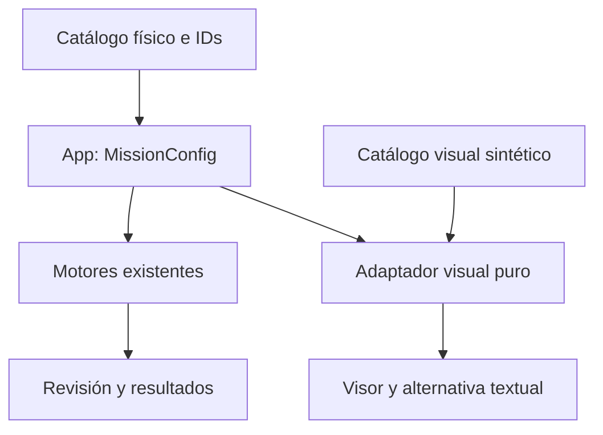

# Arquitectura de Mission Architect 2.0

Estado: diseño para implementación posterior. Este PR solo modifica documentación.
Base inspeccionada: `feature/initial-game-scaffold`, commit `1092772980cb2ff526432e97037da5e23ba42bbc` (14-11-2026).
`main` contiene únicamente README.md en `23fbb8f43da7f620141da747fae1bab1dcc6a1af`; el MVP está en el PR #1.

## 1. Objetivo y decisión mínima

Incorporar un visor de inspección de satélite que refleje los componentes seleccionados sin alterar la física, los resultados ni las fases del juego. No crear otra aplicación.

Decisión ADR-001: conservar `MissionConfig`, `SpaceComponent`, `DesignAssessment`, `OrbitProfile` y `MissionResult` sin modificaciones. La geometría pertenece a la presentación; su catálogo se mantiene separado de `src/data/catalog.ts`. No se necesita cambiar `src/types/contracts.ts` para este incremento.

El camino más corto para el hackatón es un bus esquemático con primitivas procedurales y cuatro categorías, sin GLB, editor CAD, ensamblaje libre, animación orbital, postprocesado ni motor de cuerpos rígidos. Si falla el visor, las tarjetas existentes siguen siendo la experiencia funcional.

## 2. Arquitectura observada

- `App.tsx`: estado local de fase, configuración, resultado y error; tarjetas, gráficos y navegación en un único archivo.
- `catalog.ts`: ocho componentes, dos lanzadores, valores fijos del bus, límites y misión inicial; parámetros de hardware sintéticos.
- `resources.ts`: resuelve IDs y evalúa masa, costo, potencia, capacidad y restricciones.
- `orbit.ts`: perfil circular, eclipse idealizado y ventana de contacto ficticia.
- `game.ts`: simulación determinista de energía y datos y puntuación; invoca los otros motores.
- `contracts.ts`: contratos de dominio sin dependencias de React o Three.
- No existen visor 3D, catálogo visual, adaptador visual, documento de arquitectura ni lockfile en la base inspeccionada.

## 3. Flujo propuesto



Los motores no importan presentación. El visor no importa motores ni el estado global de la aplicación. App entrega solo IDs al adaptador; el visor recibe el modelo derivado. No hay flujo de geometría hacia física. Los presupuestos se muestran con el DesignAssessment ya calculado por App.

Resaltar un componente significa inspeccionarlo, no equiparlo. La selección de hardware sigue pasando por las tarjetas y el estado MissionConfig existente. Sin almacenamiento duplicado de la configuración en el visor.

## 4. Interfaces propuestas (no implementadas)

Destino futuro: `src/visualization/types.ts`. Importar únicamente tipos de dominio. No exportar objetos Three.js a través de este límite.

```ts
import type { ComponentCategory, MissionConfig } from "../types/contracts";

export type Vec3 = readonly [number, number, number];
export type VisualKind = "box" | "cylinder" | "panel";

export interface VisualPart {
  readonly partId: string; // Único dentro del descriptor del componente
  readonly kind: VisualKind;
  readonly positionM: Vec3;
  readonly rotationRad: Vec3; // Euler XYZ, radianes
  readonly dimensionsM: Vec3; // Extensión local XYZ positiva
  readonly colorHex: string;
}

export interface ComponentVisualDefinition {
  readonly componentId: string; // Coincide exactamente con SpaceComponent.id
  readonly category: ComponentCategory;
  readonly label: string; // Nombre mostrado, debe coincidir con catálogo físico
  readonly geometryProvenance: "synthetic";
  readonly parts: readonly VisualPart[];
}

export type VisualCatalog = Readonly<
  Record<string, ComponentVisualDefinition>
>;

export interface VisualIssue {
  readonly componentId: string;
  readonly code: "unknown-component" | "missing-visual" |
    "invalid-visual" | "duplicate-id";
  readonly message: string;
}

export interface SpacecraftVisualModel {
  readonly schemaVersion: 1;
  readonly geometryProvenance: "synthetic";
  readonly busParts: readonly VisualPart[];
  readonly components: readonly ComponentVisualDefinition[];
  readonly issues: readonly VisualIssue[];
}

export interface SpacecraftViewerProps {
  readonly model: SpacecraftVisualModel;
  readonly highlightedComponentId?: string;
  readonly onInspectComponent?: (componentId: string) => void;
  readonly className?: string;
}

// Firma propuesta para buildSpacecraftVisualModel.ts.
// No es una función implementada ni un stub de producción.
export type BuildSpacecraftVisualModel = (
  selectedIds: readonly string[],
  catalog: VisualCatalog,
  knownComponents: readonly {
    readonly id: string;
    readonly category: ComponentCategory;
    readonly name: string;
  }[]
) => SpacecraftVisualModel;

// La frontera de configuración utiliza solo este campo existente.
export type VisualSelection = Readonly<
  Pick<MissionConfig, "selectedComponentIds">
>;
```

Responsabilidades:

| Límite | Entrada | Salida | Propietario |
|---|---|---|---|
| Tarjetas → App | Categoría e ID | Nuevo MissionConfig | Integrador |
| App → evaluateDesign | MissionConfig actual | DesignAssessment | Integrante 3 |
| App → computeOrbitProfile | altitudeKm | OrbitProfile | Integrante 2 |
| Acción de simular → runMission | MissionConfig, seed | MissionResult | Integrante 5 |
| App → adaptador | IDs, catálogo visual, IDs/nombres/categorías del catálogo físico | SpacecraftVisualModel | Integrante 4 |
| Modelo → visor | SpacecraftViewerProps | Vista y evento de inspección opcional | Integrante 4 |
| Visor → App | ID inspeccionado | Resaltado visual, nunca cambio de hardware | Integrador |

No pasar MissionResult al visor inicial. No añadir callbacks de fuerza, masa, potencia, despliegue físico o ejecución de misión.

## 5. Mapeo y algoritmo del adaptador

Complejidad esperada O(N + K + P): indexar N componentes conocidos, resolver K IDs seleccionados y copiar P partes. No optimizar para grandes escenas: hoy N = 8 y K = 4.

1. Indexar IDs/nombres/categorías conocidos; crear un modelo nuevo sin mutar entradas.
2. Recorrer IDs en orden determinista. Reportar duplicados sin duplicar mallas.
3. ID desconocido: issue unknown-component y representación textual del problema. ID conocido sin descriptor: issue missing-visual y nombre del componente en fallback.
4. Validar identidad, categoría, nombre, procedencia y geometría del descriptor. Coordenadas y ángulos finitos; dimensiones positivas; color válido; partId único por componente. En caso inválido, reportar invalid-visual y no montar esa geometría.
5. Copiar partes válidas al modelo. No corregir ni completar silenciosamente la configuración de ingeniería.
6. Un error en la preparación visual nunca bloquea las tarjetas, revisión o simulación; el contenedor presenta fallback. La validación de diseño sigue perteneciendo a resources.ts.
7. Claves de nodos: componentId + ":" + partId. Reservar un espacio de nombres distinto para el bus.

| ID existente | Representación prevista, siempre sintética |
|---|---|
| camera-basic | Cuerpo de cámara compacto |
| camera-hd | Cámara distinta por forma/tamaño esquemático |
| solar-basic | Par de paneles estándar, un único componente físico |
| solar-advanced | Par de paneles visualmente ampliados |
| battery-basic | Batería interna identificable en lista/vista esquemática |
| battery-advanced | Variante interna diferenciada |
| radio-basic | Antena esquemática |
| radio-advanced | Variante de antena diferenciada |

El bus visual corresponde al bus fijo ya contado por resources.ts. No tiene entrada adicional en selectedComponentIds y no se suma de nuevo su masa/costo/potencia.

## 6. Unidades y validez física

- Escena local: 1 unidad = 1 metro de geometría sintética, sistema derecho, +Y arriba, +X lado de paneles, +Z frente del modelo. No es un marco orbital ECI/ECEF ni actitud de vuelo.
- Todas las dimensiones son ilustrativas; usar el rótulo visible "Geometría esquemática sintética; no es un modelo CAD".
- Para box/panel, dimensionsM son anchura, altura y profundidad locales. Para cylinder, el eje es Y, X y Z deben ser iguales y representan diámetro; Y es longitud. El renderer deriva radio = X/2.
- Cámara y vista explosionada alteran transformaciones de presentación; no alteran dimensiones de ingeniería ni sugieren despliegue físico.
- No convertir kg en volumen, W en área de panel ni MB/min en tamaño de antena. El catálogo no contiene densidades, eficiencias, geometría de paneles o enlaces suficientes para esas inferencias.
- Mantener km, km/s y s en órbita; kg, W, Wh y créditos en diseño; MB y MB/min en datos. No tratar créditos como moneda real.

Fórmulas existentes, únicamente documentadas aquí: r = R_E + h; T = 2π√(r³/μ); v = √(μ/r); f_e = asin(R_E/r)/π; ΔE = (P_gen − P_load)Δt/3600, con Δt en segundos y E en Wh. Órbita circular de dos cuerpos, Tierra esférica y beta solar cero para eclipse. Valores actuales: R_E = 6371 km y μ = 398600.4418 km³/s². La ventana 0.78–0.96 del ciclo es ficticia.

No duplicar estas fórmulas en el adaptador o renderer. Una futura animación temporal exigiría un ADR independiente: los historiales actuales son valores submuestreados sin marcas de tiempo, no telemetría orbital. Nunca hacer pasar una animación decorativa por propagación validada.

## 7. Archivos y dependencias

Este PR modifica AGENTS.md y PROJECT_SPEC.md y crea ARCHITECTURE.md, TEAM_INTEGRATION.md, MODULE_1_PROMPT.md y ARCHITECTURE_REVIEW.md. Nada en src, tests o configuración cambia.

Archivos previstos para el PR posterior del integrante 4:

- src/visualization/types.ts
- src/visualization/catalog.ts
- src/visualization/buildSpacecraftVisualModel.ts
- src/visualization/SpacecraftViewer.tsx
- src/visualization/SpacecraftScene.tsx
- src/visualization/SpacecraftFallback.tsx
- src/visualization/spacecraft-viewer.css
- tests/visualization.test.ts

No se crean archivos vacíos para simular avance. El integrador conectará App.tsx y añadirá dependencias en PRs separados coordinados.

Dependencias propuestas: three y @react-three/fiber de la línea 9 compatible con React 19; @types/three para desarrollo. No instalar en este PR. El integrador verificará versiones exactas y peerDependencies, resolverá y registrará package-lock.json y ejecutará npm ci/build/test antes de que el visor se integre. Drei es opcional solo si un control concreto reduce trabajo; no añadirlo preventivamente.

Referencia primaria consultada 14-11-2026: [React Three Fiber: introducción y compatibilidad](https://r3f.docs.pmnd.rs/getting-started/introduction). Documenta la correspondencia Fiber 9 / React 19. No tomar una versión alpha como requisito de este incremento.

## 8. Resiliencia y criterios verificables

Cargar el visor bajo demanda con React.lazy/Suspense y un error boundary limitado al panel. Manejar WebGL no disponible y pérdida de contexto explícitamente; un error boundary por sí solo no captura todos los eventos de canvas. Fallback HTML con nombres e issues, opción de desactivar 3D y controles accesibles. Liberar listeners y recursos al desmontar; probar StrictMode, montaje repetido y resize.

Pruebas futuras: cobertura de ocho IDs; ID desconocido; descriptor ausente/mal formado; partes múltiples; batería interna; no mutación con entradas congeladas; determinismo de adaptador; separación de imports; igualdad profunda de resultados de misión antes/después de interacciones reales con el visor. No basta invocar dos veces runMission sin montar el visor.

Mantener los 12 tests existentes, además de pruebas del adaptador. QA ejecuta el recorrido completo sin WebGL y con viewer activo, selección de las cuatro categorías, revisión inválida, regreso a diseño y debrief. Registrar dispositivo, navegador, errores de consola y evidencia; no inventar FPS. Si hay degradación visible en el equipo de demo, reducir detalle o dejar el visor optativo.

## 9. Riesgos, prioridad y complejidad

| Trabajo/riesgo | Mitigación | Prioridad / estimación orientativa |
|---|---|---|
| MVP aún fuera de main | PR apilado; verificar #1 y recorrido antes de integrar | P0 / baja |
| Resultados antiguos y temporizador pendiente | Corrección de App en PR separado antes del cableado | P0 / media |
| Contratos y archivos compartidos | Un dueño por archivo; sin cambio de contracts.ts | P0 / baja |
| Catálogo y adaptador visual | IDs estables, fallback explícito y pruebas puras | P1 / baja-media, 2–4 h |
| Dependencias y lockfile ausente | Instalación única del integrador y CI reproducible | P1 / media, 1–2 h |
| Visor procedural accesible | Panel aislado, carga diferida, sin assets remotos | P1 / media, 4–8 h |
| QA e integración | Recorrido, fallos de WebGL y regresión | P1 / media, 2–4 h |
| CAD, GLB, orbital 3D y replay | Diferir a otra propuesta con datos y pruebas | P2 / alta |

Horas orientativas de trabajo enfocado, no promesas; dependen de experiencia y disponibilidad del entorno. La arquitectura documental es de complejidad baja-media. El visor no condiciona las mejoras independientes de los motores.
